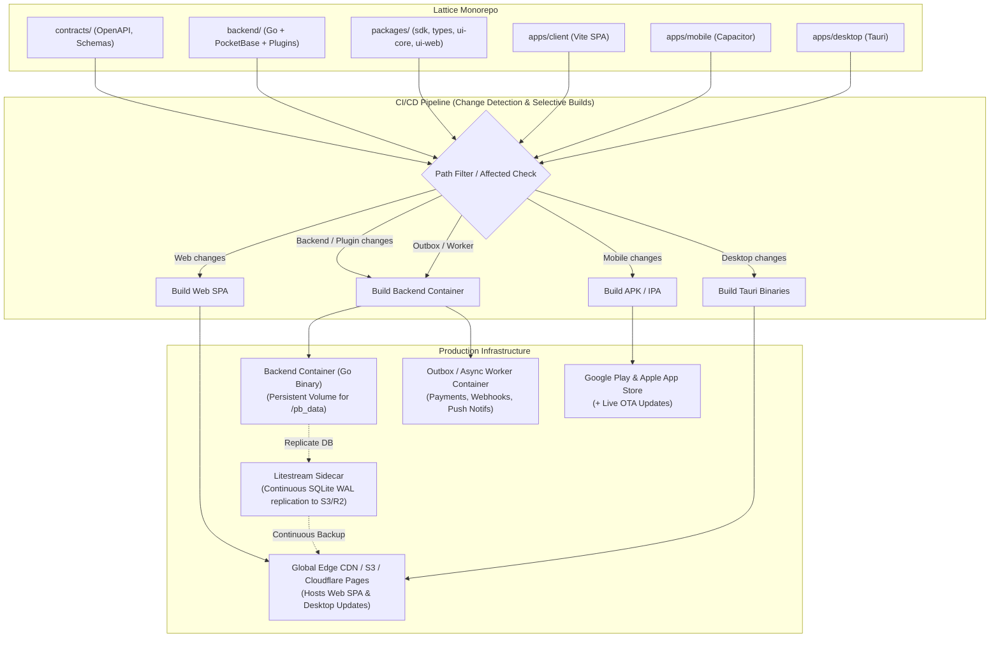
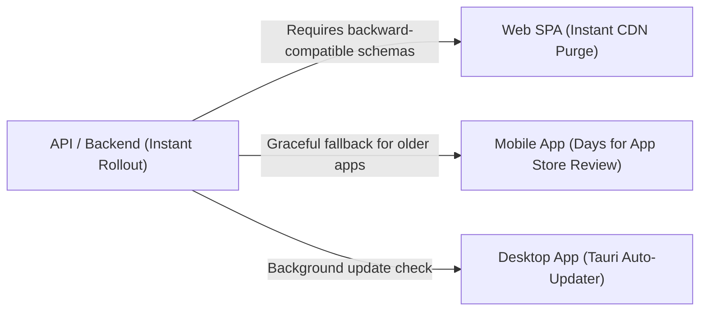

# Lattice Deployment & Multi-Service Architecture Guide

This document defines the deployment architecture, scaling strategy, and CI/CD operations for **Lattice** as the project grows to encompass multiple services, backend modules, and multi-platform clients.

---

## 1. Architectural Overview & Context

Lattice is structured as a monorepo consisting of:
- **Backend**: Go application embedding [PocketBase](https://pocketbase.io) (`backend/cmd/server`), using SQLite with WAL mode, custom REST APIs (`/v1/*`), dynamic migrations, transactional outbox, and a modular plugin system (`backend/internal/plugins/*`).
- **Shared Libraries & Contracts**:
  - `contracts/`: Single Source of Truth (OpenAPI specifications, JSON Schemas, initial collection definitions).
  - `packages/types`: Code-generated TypeScript definitions.
  - `packages/sdk`: Client SDK wrapping PocketBase JS SDK with platform adapters.
  - `packages/ui-core`: Headless state logic, layout engine, and form management.
  - `packages/ui-web`: Shared React UI components.
- **Client Applications**:
  - `apps/client`: Web Admin & App SPA (React 19 + Vite).
  - `apps/mobile`: Mobile App for field teams (Capacitor for Android & iOS).
  - `apps/desktop`: Desktop App (Tauri v2 bundling `apps/client`).
  - `apps/site`: Landing page and public documentation.



---

## 2. Monorepo CI/CD & Change Detection (Selective Builds)

As the number of modules and targets increases, building all targets on every push degrades developer velocity. A **Selective / Affected CI/CD** strategy must be enforced:

### Dependency Trigger Matrix

| Changed Path | Affected Scope | Required CI Steps |
| :--- | :--- | :--- |
| `contracts/**` | **Everything** | Codegen (`pnpm gen:check`), check OpenAPI, typecheck all packages, build all apps. |
| `packages/types/**` | SDK, UI, Apps | Rebuild SDK, UI packages, verify apps. |
| `packages/sdk/**` or `packages/ui-core/**` | Client, Mobile, Desktop | Run package tests, build Web SPA, run E2E smoke tests. |
| `backend/**` | Backend only | `go test -race ./...`, `go vet`, build Docker image (`backend/Dockerfile`). |
| `apps/client/**` | Web Client | Lint, typecheck, build Vite bundle, deploy to CDN/Preview. |
| `apps/mobile/**` | Mobile (iOS/Android) | Run Capacitor sync, trigger Android Gradle / iOS Xcode builds. |
| `apps/desktop/**` | Desktop (Tauri) | Run Tauri build & signing matrix. |

### Path-Filtering Implementation Pattern (GitHub Actions)

In `.github/workflows/ci.yml`, replace monolithic runs with conditional path filters:

```yaml
jobs:
  changes:
    runs-on: ubuntu-latest
    outputs:
      backend: ${{ steps.filter.outputs.backend }}
      frontend: ${{ steps.filter.outputs.frontend }}
      mobile: ${{ steps.filter.outputs.mobile }}
      contracts: ${{ steps.filter.outputs.contracts }}
    steps:
      - uses: actions/checkout@v4
      - uses: dorny/paths-filter@v3
        id: filter
        with:
          filters: |
            contracts:
              - 'contracts/**'
              - 'tools/codegen/**'
            backend:
              - 'backend/**'
              - 'contracts/**'
            frontend:
              - 'apps/client/**'
              - 'packages/**'
              - 'contracts/**'
            mobile:
              - 'apps/mobile/**'
              - 'packages/**'
              - 'contracts/**'
```

---

## 3. Backend Deployment & SQLite High Availability

PocketBase relies on embedded **SQLite** with Write-Ahead Logging (WAL). SQLite supports high-throughput concurrent reads, but enforces a **single writer process** per database file.

### Recommended Production Topology: Container + Litestream

Deploy the backend as a single container running alongside [Litestream](https://litestream.io/) to continuously stream WAL frames to object storage (AWS S3, Cloudflare R2, or MinIO):

```
+-----------------------------------------------------------+
| Host / VM (Fly.io, AWS ECS, or Hetzner VPS)               |
|                                                           |
|   +-------------------+          +--------------------+   |
|   | Lattice Backend   |  writes  | Local Storage      |   |
|   | (PocketBase Core) | -------> | /pb_data/data.db   |   |
|   +-------------------+          +--------------------+   |
|                                            |              |
|                                     reads WAL frames      |
|                                            v              |
|                                  +--------------------+   |
|                                  | Litestream Sidecar |   |
|                                  +--------------------+   |
+--------------------------------------------|--------------+
                                             | continuous stream
                                             v
                                  +--------------------+
                                  | Cloudflare R2 / S3 |
                                  | (RPO < 1s Backup)  |
                                  +--------------------+
```

### Production Dockerfile (`backend/Dockerfile` with Litestream)

```dockerfile
# Build Stage
FROM golang:1.27-alpine AS build
WORKDIR /src
COPY go.mod go.sum ./
RUN go mod download
COPY . .
RUN CGO_ENABLED=0 go build -o /out/server ./cmd/server

# Runtime Stage
FROM alpine:3.20
RUN apk add --no-cache ca-certificates

# Install Litestream for SQLite continuous replication
ADD https://github.com/benbjohnson/litestream/releases/download/v0.3.13/litestream-v0.3.13-linux-amd64.tar.gz /tmp/
RUN tar -C /usr/local/bin -xzf /tmp/litestream-v0.3.13-linux-amd64.tar.gz && rm /tmp/litestream-v0.3.13-linux-amd64.tar.gz

COPY --from=build /out/server /app/server
COPY NOTICE LICENSE.md LICENSE-PRODUCT.md THIRD_PARTY_LICENSES.md /licenses/

ENV TENANT_CONFIG=/config/tenant.json
ENV FEATURES_CONFIG=/config/features.json
VOLUME /pb_data
EXPOSE 8090

# Litestream runs replication and execs the PocketBase server
ENTRYPOINT ["litestream", "replicate", "-exec", "/app/server serve --http=0.0.0.0:8090 --dir=/pb_data"]
```

### Litestream Configuration (`backend/litestream.yml`)

```yaml
dbs:
  - path: /pb_data/data.db
    replicas:
      - type: s3
        bucket: lattice-db-backups
        path: production/data.db
        endpoint: https://<account_id>.r2.cloudflarestorage.com
        access-key-id: ${LITESTREAM_ACCESS_KEY_ID}
        secret-access-key: ${LITESTREAM_SECRET_ACCESS_KEY}
```

### Multi-Tenant Scaling Models

Depending on growth and isolation requirements, choose between:
1. **Shared Multi-Tenant Instance (Current Model)**:
   - All tenants share the same SQLite database with `workspace_id` filtering and authorization rules (`backend/internal/platform/authz`).
   - Best for SMEs, cost-effective, easy maintenance.
2. **Per-Tenant Isolated Instances (Enterprise Model)**:
   - Spin up a dedicated micro-container for each tenant on demand (using the Fly.io Machines API or Docker Swarm/Kubernetes).
   - Zero noisy-neighbor problems, complete data isolation, individual backup cycles.

---

## 4. Service & Module Decoupling

### Modular Monolith Strategy
Do not prematurely decompose internal Go packages into distinct network microservices. Keep modules (such as `backend/internal/plugins/payments`) compiled into the single binary:
- **Zero Network Latency**: In-process Go function calls instead of gRPC/REST hops.
- **Atomic Database Transactions**: Plugins can write to business tables and the Transactional Outbox table in the same transaction.
- **Feature Flag Control**: Toggle modules per workspace via `features.json` or dynamic workspace config.

### Dedicated Outbox Worker (Async Tasks)
To prevent heavy tasks (PDF generation, email delivery, payment provider webhooks, notifications) from degrading API latency:
1. Business actions write to the `_outbox` table (`1790000000_create_outbox.go`).
2. Run a decoupled worker container (using the same Go codebase with a `--worker` flag):
   ```bash
   /app/server worker outbox --dir=/pb_data
   ```
3. The worker processes queued events, delivers webhooks, and commits status updates.

---

## 5. Multi-Platform Release Engineering

Each platform client operates under different distribution cycles:



### 1. Web SPA (`apps/client`)
- **Hosting**: Cloudflare Pages, Vercel, or AWS S3 + CloudFront.
- **Workflow**:
  1. `pnpm --filter @lattice/client build` outputs static files to `apps/client/dist`.
  2. Upload to static host with cache-control headers (`index.html` `no-cache`, assets immutable with hashes).
  3. Supports instant atomic rollbacks and PR preview URLs.

### 2. Mobile App (`apps/mobile`)
- **Native Packaging**: Capacitor builds Android (`.apk`/`.aab`) and iOS (`.ipa`).
- **Review Delay**: Apple App Store and Google Play take 1-3 days for approval.
- **Over-The-Air (OTA) Live Updates**:
  - Integrate Capacitor Live Updates (e.g., Capgo / Ionic Appflow).
  - Web UI changes, bug fixes, and layout configurations can be pushed to users instantly without store re-review.
  - Native plugin updates still require standard app store submission.

### 3. Desktop App (`apps/desktop`)
- **Packaging**: Tauri bundles the web assets with native OS wrappers (Windows `.msi`/`.exe`, macOS `.dmg`, Linux `.AppImage`).
- **Auto-Update**:
  - Tauri `updater` endpoint checks a hosted `update.json` on Cloudflare R2 / S3.
  - Desktop apps download and apply updates silently or on restart.

### 4. Contract-First Backward Compatibility Rule
Because mobile and desktop clients cannot be updated instantaneously across all users:
- **Strictly Follow the Expand-Contract Pattern**:
  - **Expand**: Add new optional fields or new endpoints. Old clients continue working.
  - **Migrate**: Update all client apps to use the new endpoints/fields.
  - **Contract**: Only deprecate and remove old fields after the oldest supported client version has reached End of Life (EOL).
- **Semver OpenAPI Spec**: Version API contracts (`/v1/*`, `/v2/*`) in `contracts/openapi.yaml`.

---

## 6. Environments & Configuration Management

| Environment | Purpose | Target URL | Configuration Source |
| :--- | :--- | :--- | :--- |
| **Development** | Local coding | `localhost:5173` / `127.0.0.1:8090` | `backend/tenant.json`, `features.json` |
| **Preview / Staging** | PR verification & E2E tests | `staging.lattice.app` | GitHub Secrets / Staging config volume |
| **Production** | Live end-users | `app.lattice.app` / `api.lattice.app` | Cloud Secret Manager (mounted to `/config`) |

### Secrets & Config Mounting in Production

Never hardcode credentials or tenant IDs. The Docker container expects configuration mounts:
- `TENANT_CONFIG`: `/config/tenant.json`
- `FEATURES_CONFIG`: `/config/features.json`
- `DATA_DIRECTORY`: `/pb_data` (mounted to a persistent SSD volume)

---

## 7. Zero-Downtime Deployment & Database Migration Procedure

PocketBase registers migrations via `migratecmd.MustRegister`. To safely upgrade production with SQLite:

1. **Pre-Deployment Backup**:
   - Trigger Litestream snapshot or execute PocketBase backup via CLI:
     ```bash
     /app/server backup create pre-deploy-$(date +%s) --dir=/pb_data
     ```
2. **Execute Schema Migrations**:
   - Run the migration step against the database volume before shifting traffic:
     ```bash
     /app/server migrate up --dir=/pb_data
     ```
3. **Graceful Binary Restart**:
   - With SQLite, avoid two instances writing simultaneously. Use rolling update with `maxSurge: 0, maxUnavailable: 1` or a brief fast-swap (<2s) container restart.
   - PocketBase starts in under 100ms.
4. **Health Check Validation**:
   - Verify that `/v1/health` responds with `{"status":"ok"}`.
   - If health check fails within 10 seconds, rollback the container and restore the pre-deployment backup.

---

## 8. Implementation Roadmap

- [ ] **Phase 1: Selective CI/CD Pipelines**
  - Add path filtering to `.github/workflows/ci.yml`.
  - Cache pnpm store and Go build caches between runs.
- [ ] **Phase 2: Production Containerization**
  - Update `backend/Dockerfile` with Litestream.
  - Create `docker-compose.prod.yml` template with persistent volume and Litestream environment configuration.
- [ ] **Phase 3: Client Distribution Automation**
  - Set up Cloudflare Pages / S3 deployment for `apps/client`.
  - Add Tauri release action for Windows and macOS desktop binaries.
  - Configure Capgo / OTA updates for `apps/mobile`.
- [ ] **Phase 4: Outbox Worker Isolation**
  - Add a dedicated worker mode CLI command to `backend/cmd/server/main.go` for background event processing.
